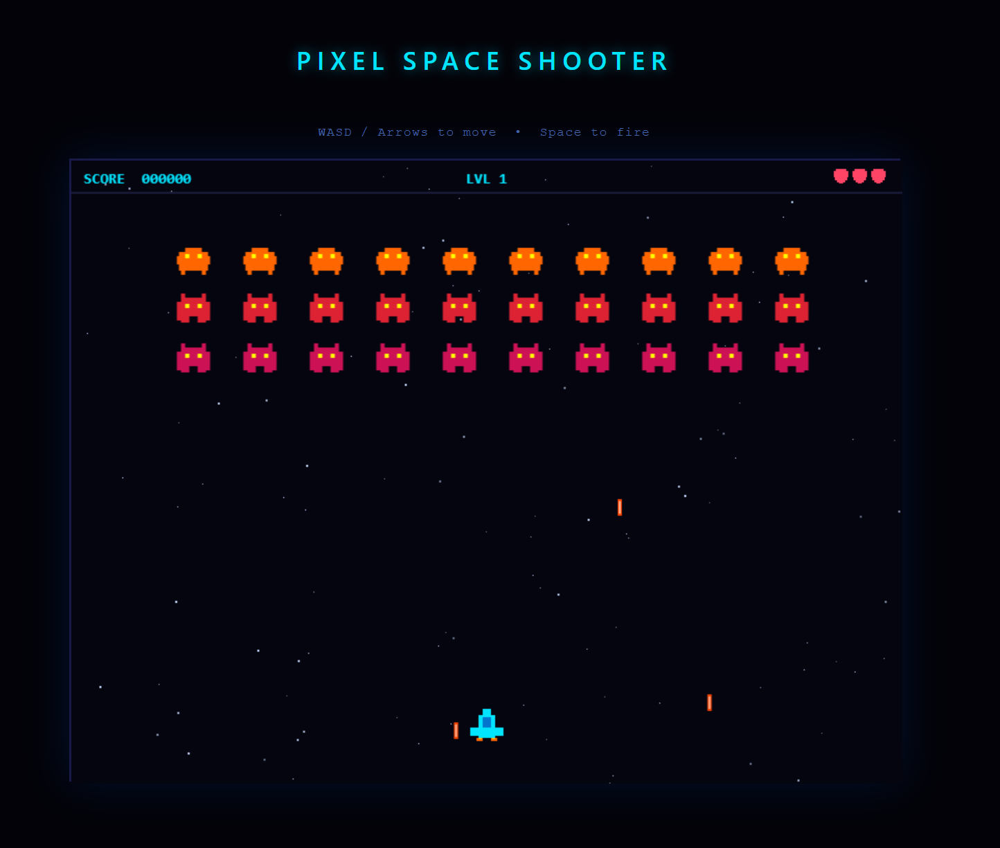

# Pixel Space Shooter

A 60 fps retro pixel-art space shooter built with React 19, TypeScript, and Canvas 2D.

[](https://bropilot-ai.github.io/Pixel-Shooter/)



## Features

- Classic Space Invaders–style enemy formation with increasing difficulty per level
- Pixel-art sprites drawn entirely in code (no external assets required)
- Immutable pure-function game engine
- 2-second invincibility frames after being hit
- High score persisted in `localStorage`
- 63 KB gzipped bundle

## Controls

| Key | Action |
|-----|--------|
| `W` / `↑` | Move up |
| `S` / `↓` | Move down |
| `A` / `←` | Move left |
| `D` / `→` | Move right |
| `Space` | Fire |
| `R` / `Enter` | Restart (game over screen) |

## Architecture

```
src/
├── core/
│   ├── types.ts          # Readonly TypeScript interfaces
│   ├── GameEngine.ts     # Pure tick() function — all game logic
│   ├── Renderer.ts       # Canvas drawing (stateless)
│   └── Input.ts          # useKeySet() — key tracking with zero re-renders
├── components/
│   ├── CanvasGame.tsx    # RAF loop + state ref, syncs to React only on status change
│   └── GameUI.tsx        # Game-over overlay (React DOM)
└── utils/
    └── useLocalStorage.ts
```

The engine follows a pure data-flow model: `tick(keys, state) → state`. No DOM access, no side effects — every function takes a `GameState` and returns a new one. This makes the logic easy to extend.

## Getting Started

```bash
npm install
npm run dev
```

## Build

```bash
npm run build
```

Output in `dist/` — deployable to Netlify, Vercel, or any static host.

## Tech Stack

- [React 19](https://react.dev)
- [TypeScript 5.9](https://www.typescriptlang.org) (strict mode)
- [Vite 8](https://vite.dev)
